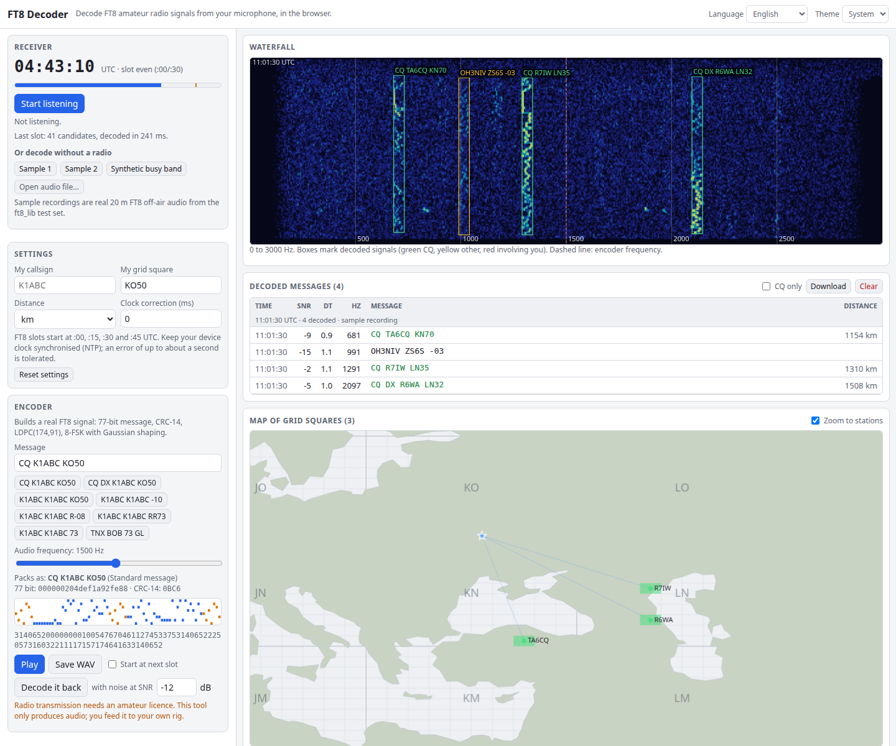

# FT8 Decoder

Decode FT8 amateur radio signals from your microphone, entirely in the browser. It listens in 15-second UTC slots, shows a live waterfall, lists the decoded messages (SNR, time offset, frequency, distance) and puts the stations on a map of Maidenhead grid squares. It also has an FT8 encoder, so you can build a real signal, play it, save it as WAV and decode it back. Nothing is uploaded: audio never leaves your device.

**Try it: [hermes98761234.github.io/ft8-decoder-web](https://hermes98761234.github.io/ft8-decoder-web/)**

[](https://github.com/hermes98761234/ft8-decoder-web/actions/workflows/deploy.yml)



## Features

- **Live receive.** Microphone or line-in through Web Audio, split into UTC-aligned 15 s slots (:00, :15, :30, :45). Each slot is decoded in a Web Worker the moment it ends. A manual clock correction handles a drifting device clock.
- **Waterfall** from 0 to 3000 Hz, scrolling live, with a box and callsign on every decoded signal. Green is CQ, yellow is other traffic, red involves your callsign. Click a box to select the message.
- **Decoded message list** with SNR, DT, audio frequency, message text and distance from your grid square. CQ filter, download as WSJT-X-style text, standard, non-standard and free-text messages, and hashed callsigns `<...>` resolved from earlier slots.
- **Map of grid squares.** A built-in world outline (no map tiles, no network), Maidenhead grid, stations at the centre of the square they sent, lines from your locator.
- **Encoder.** Type a message (`CQ K1ABC FN42`, `K1ABC W9XYZ -11`, free text, non-standard callsigns), see the 77 bits, CRC and the 79 tones, play it, save a 15 s 12 kHz WAV, or decode it back at a chosen SNR. It can start playing at the next slot boundary.
- **Works without a radio.** Two real 20 m off-air recordings, a synthetic busy band, or open your own WAV/MP3/OGG file (long recordings are cut into 15 s slots).
- **English and Ukrainian, light, dark or system theme**; settings (callsign, grid, units, clock correction) are kept in the browser.

## How it works

There is no `emcc` on the build machine, so instead of compiling [kgoba/ft8_lib](https://github.com/kgoba/ft8_lib) (MIT) to WASM the decoder is a **TypeScript port** of it, in `src/lib`:

1. **Resample** to 12 kHz with a windowed-sinc filter (`resample.ts`).
2. **Waterfall** (`waterfall.ts`): Hann-windowed FFT of two symbols (0.32 s), every half symbol (0.08 s) at 2x frequency oversampling, in 0.5 dB steps. A mixed-radix FFT (`fft.ts`) handles the 3840-point size.
3. **Sync search** (`decode.ts`): score every time and frequency offset against the 7x7 Costas pattern, keep the 140 best candidates.
4. **Soft decoding**: log-likelihoods for the 174 bits from the 8 tone powers, then belief-propagation decoding of the LDPC(174,91) code (`ldpc.ts`, tables from WSJT-X) and a CRC-14 check (`crc.ts`). A candidate is only accepted if all 83 parity checks and the CRC pass, so false decodes are very rare.
5. **Unpack** the 77 bits into text (`message.ts`): standard messages with grid, report, RRR/RR73/73, /R and /P suffixes, CQ with modifiers, non-standard callsigns with 12-bit hashes, free text and telemetry.
6. **SNR** is estimated against the noise floor next to the signal and scaled to the 2500 Hz reference bandwidth like WSJT-X (calibrated on synthetic signals with known SNR to about 1 dB).

The encoder (`encode.ts`) does the reverse: pack, CRC-14, LDPC(174,91), Gray-mapped 8-FSK with the Costas arrays, then Gaussian-shaped frequency synthesis (BT = 2.0).

### Tested against real signals

`src/lib/slot.test.ts` decodes two off-air recordings from the ft8_lib test set and compares them with what WSJT-X decoded (text, frequency, DT, SNR), re-packs every decoded text and checks it gives back the transmitted 77 bits, and checks 44.1 and 48 kHz resampling. Synthetic tests cover seven simultaneous signals from 0 dB down to -16 dB, signals 50 Hz apart, noise only (no false decodes), start-time errors up to a second and hashed callsigns across slots. The CRC, LDPC (parity checks of every encoded word, BP correction of noisy words), FFT, message packing, WAV, resampling and locator maths have their own unit tests.

### Limitations

- The decoder follows ft8_lib: it is a single pass and finds roughly as many signals as ft8_lib does, a bit fewer than WSJT-X, which also subtracts decoded signals and tries several decoders on weak ones. Signals weaker than about -18 dB are usually missed.
- Message types other than standard, non-standard callsign, free text and telemetry (DXpedition mode, Field Day, contest RTTY) are CRC-valid but shown as `[i3.n3 ...]`.
- Your device clock must be close to UTC. Decoding tolerates about a second of error; use the clock correction setting if you are further off. DT shows your offset plus the audio input latency.
- Reading the microphone needs a secure context (HTTPS or localhost) and your permission. Pick an input without echo cancellation if you have several.
- Transmitting on the air needs an amateur radio licence. The encoder only produces audio.

## Quick start

You need [Node.js](https://nodejs.org/) 22.

```bash
git clone https://github.com/hermes98761234/ft8-decoder-web.git
cd ft8-decoder-web
npm install
npm run dev       # http://localhost:5173
npm test          # decoder, encoder and utility tests (about 10 s)
npm run build     # static site in dist/
```

## Credits

The decoder algorithm and the LDPC(174,91) tables come from [ft8_lib](https://github.com/kgoba/ft8_lib) by Kārlis Goba (MIT) and WSJT-X by Joe Taylor, K1JT, and the WSJT Development Group. The two sample recordings are from the ft8_lib test set. The coastline is `land-110m` from [world-atlas](https://github.com/topojson/world-atlas) (Natural Earth, public domain).

## License

MIT
